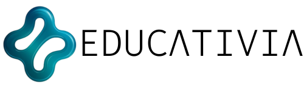

<div align="center">



# Educativia

<!-- badges -->
     

[Ler em Português](README.md)

A teaching copilot that uses artificial intelligence to create, adapt and organize lesson plans aligned with the BNCC (Brazil's national curriculum), giving teachers their time back.

[Clickable Figma prototype](https://aged-sleek-15809251.figma.site)

</div>

## About

Academic project by Squad 15 at Cesar School, tied to UN Sustainable Development Goal 4 (Quality Education). It targets teacher overload in Brazilian basic education: for every 50-minute class, a teacher may spend up to 3 hours preparing, on top of adapting content for mixed-level classes.

The repository holds the prototype front end, exported from Figma Make in React and TypeScript. Screens use mocked data; there is no back end and no real AI integration.

## Proposal

| Feature | Description |
| --- | --- |
| AI lesson planning | Generates lesson plans in minutes, using active learning methods |
| Content adaptation | Adjusts materials for different levels and needs |
| Schedule management | Organizes the calendar and class timetable |
| Community | Teachers share practices with each other |

## Design process

Built with Design Thinking (Double Diamond) and Lean UX:

- **Discovery:** CSD matrix and benchmark against Profy, Eduaide and Plurall. Differentiator: explicit BNCC focus and a built-in bank of active learning methods.
- **Personas:** Carlos Menezes, a 42-year-old public school teacher with few resources and mixed-level classes; Marta Oliveira, a 56-year-old coordinator who wants to standardize plans without losing quality.
- **Lean Canvas:** complete lesson plans in minutes, with a system that improves as the community uses it.
- **References:** Viegas (2022) and Moriconi et al. (2021) on the intensification of teachers' work.

## Screens

| Screen | Component | Description |
| --- | --- | --- |
| Home | `HomeScreen` | Overview and shortcut to a new plan |
| Canvas | `CanvasEditor` | Block-based lesson plan editor |
| Copilot | `AIBottomSheet` | AI suggestions for the selected block |
| Library | `LibraryScreen` | Saved methods and plans |
| Schedule | `ScheduleManager` | Class timetable |
| Community | `CommunityFeed` | Experience sharing between teachers |
| Profile | `ProfileScreen` | Teacher data and settings |

The UI text is in Portuguese.

## Tech stack

- React 18, TypeScript and Vite 6
- shadcn/ui on top of Radix UI, Lucide, Recharts
- CSS generated by Tailwind CSS 4
- Figma and Figma Make (prototyping and export)

## Running

Requirement: Node.js 18+.

```bash
git clone https://github.com/Luisr-nunes/Educativia.git
cd Educativia
npm install
npm run dev      # http://localhost:3000
```

## Squad 15

Luís Nunes, Raysa Queiroz, Cauã Rego, João Pedro Cavalcanti, Pedro Feitosa, Micaella Cabral, Rodrigo Montenegro, João Bonifácio, Luis Vilas and Lucas Valença.

## Credits

Components from [shadcn/ui](https://ui.shadcn.com/) (MIT) and photos from [Unsplash](https://unsplash.com/license); see [Attributions.md](Attributions.md).

## Related project

[CanvasAgil](https://github.com/Luisr-nunes/CanvasAgil) keeps the same Figma Make export as a reusable base.
